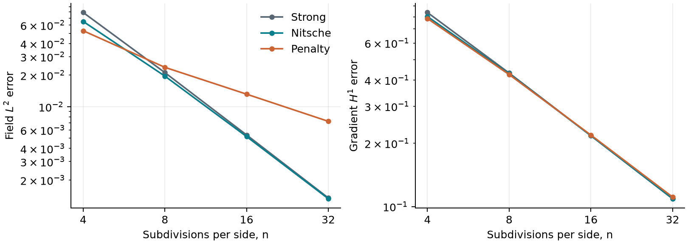
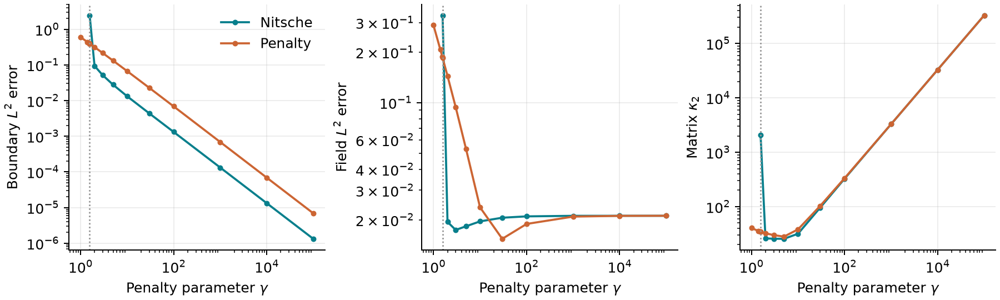

# BoundaryBalance

**When does weak boundary enforcement become accurate, stable, and unnecessarily stiff?**

BoundaryBalance compares strong elimination, boundary penalty, and symmetric Nitsche
finite elements for a dimensionless membrane/Poisson problem. It computes a
mesh-specific stability threshold, verifies it against full-matrix eigenvalues,
and separates boundary mismatch, continuum approximation error and algebraic residual.
This is an original Python implementation of established numerical methods.

[Read the academic paper](paper/paper.pdf) · [LaTeX source](paper/paper.tex) ·
[Manuscript build and provenance](paper/README.md) · [Measured data](examples/results/metrics.json)



## Main measured results

The committed experiment uses a unit square split into right triangles, with
boundary-edge length `h=1/n` and double precision. At `n=8`, the Nitsche positive
definiteness threshold is **1.56489264**. The field errors near that threshold
remain large even on its stable side. At `gamma=10`, the linear patch's maximum
nodal error is `8.88e-16` for Nitsche versus `2.68e-2` for penalty enforcement.
These last digits depend on the floating-point implementation.

For the smooth benchmark, Nitsche's final refinement orders (`n=16` to `32`) are
**1.9676 in L2** and **0.9957 in the H1 seminorm**. At `n=8`, its backward
indicator is `1.71e-16`, while its continuum L2 error is `1.96e-2`. A small
residual is not a continuum error estimate. Very large penalties reduce trace
error but drive up the unscaled matrix condition number. All values come from
[metrics.json](examples/results/metrics.json), not hand-entered reference data.

## Install and run

Requires Python 3.11 or newer. No C++ compiler is needed for this project; NumPy
and SciPy provide compiled numerical kernels. Other projects in the series have
original C++ cores. Use a virtual environment:

```bash
python -m venv .venv
# Linux/macOS: source .venv/bin/activate
# PowerShell: .venv\Scripts\Activate.ps1
python -m pip install -e ".[dev]"
boundarybalance solve --n 16 --method nitsche --gamma 10 --output output/solve.json
boundarybalance study --output output/study
```

`python -m boundarybalance.cli` is equivalent to the console entry point. A
single solve prints error metrics and can save JSON; it uses the manufactured
problem described below. `study` writes JSON, three CSV tables, and two figures
in both PNG and PDF. `--no-figures` avoids plotting for numerical automation.
Existing files in the selected output directory are replaced; no other paths
are modified. `requirements-tested.txt` records the local Python 3.14 environment;
portable dependency ranges are in `pyproject.toml`.

## Model and numerical method

On the unit square, solve

$$
-\Delta u=f,\quad u=g\text{ on }\Gamma.
$$

This is a scalar small-displacement membrane with constant unit tension, or a
unit-conductivity diffusion model. All quantities are dimensionless. Meshes
have `n*n` squares, each divided southwest-to-northeast into two CCW P1 triangles.
**Here h is boundary-edge length, not triangle diameter.**

With trial `w` and test `v`, the symmetric Nitsche form is

$$
a_\gamma(w,v)=\int_\Omega\nabla w\cdot\nabla v
-\int_\Gamma(v\partial_nw+w\partial_nv)
+\sum_e\frac{\gamma}{h_e}\int_e wv,
$$

$$
\ell_\gamma(v)=\int_\Omega fv-\int_\Gamma g\partial_nv
+\sum_e\frac{\gamma}{h_e}\int_e gv.
$$

Penalty enforcement omits both normal-flux terms (including the adjoint term in
the load). At finite gamma it is generally inconsistent with the Dirichlet
problem. Strong enforcement eliminates boundary nodes and lifts their prescribed
values into the interior right-hand side.

Assembly uses analytic P1 gradients, six-point tensor Gauss quadrature through
a Duffy map for triangle loads, and six-point edge quadrature. The P1 stiffness,
flux and boundary mass integrands are integrated exactly up to roundoff. Sparse
LU solves all linear systems. The smooth exact solution is

$$
u=1+x+2y+\sin(\pi x)\sin(\pi y),\qquad
f=2\pi^2\sin(\pi x)\sin(\pi y).
$$

The refinement study uses `n=4,8,16,32`, `gamma=10`. The parameter study fixes
`n=8`, with 13 gamma values from 1 to 100000. An independent affine patch uses
`u=0.7+1.3*x-2.1*y`, `f=0`. There is no randomness or private dataset.

### Mesh-specific stability diagnostic

Define `D=K-C-C.T`, where `C_ij=integral(phi_i*normal_gradient(phi_j))`, and
`B_ij=sum(integral(phi_i*phi_j)/h_edge)`. With boundary indices `b` and interior
indices `i`,

$$
S_0=D_{bb}-D_{bi}K_{ii}^{-1}D_{ib},\qquad
\gamma_*=\lambda_{\max}(-S_0,B_{bb}).
$$

Since `K_ii` and `B_bb` are positive definite, the full Nitsche matrix is SPD iff
`gamma > gamma_star` in exact arithmetic. The default solver checks this and
requires an additional `1e-8*max(1,abs(gamma_star))` margin. `System.matrix()`
allows inspection of smaller positive gamma values without solving them.
The eigenvalue computation is an ordinary floating-point diagnostic, not a
rigorous numerical certificate or a mesh-uniform coercivity estimate.



## Python API

```python
import numpy as np
from boundarybalance import assemble, critical_penalty, errors, solve, unit_square

mesh = unit_square(8)
g = lambda p: 0.7 + 1.3 * p[:, 0] - 2.1 * p[:, 1]
f = lambda p: np.zeros(len(p))
system = assemble(mesh, f, g)
print(critical_penalty(system))
result = solve(system, method="nitsche", gamma=10)
norms = errors(mesh, result.values, g, lambda p: np.tile([1.3, -2.1], (len(p), 1)))
```

- `unit_square(n)`: integer subdivisions, at least 2. `Mesh` is constructed by
  this factory; custom/mutated meshes are outside the supported API.
- `assemble(mesh, source, boundary, order=6)`: callback inputs have shape `(m,2)`;
  scalar outputs must be finite arrays of shape `(m,)`. Scalar broadcasting is
  intentionally rejected. Quadrature order must be an integer from 2 through 20.
- `solve(system, method, gamma)`: methods `strong`, `penalty`, `nitsche`.
  `Solution.values` contains one value per node; `backward_error` measures
  the solved equations; `gamma_star` is populated for Nitsche. Gamma is positive
  and finite; its value is unused by strong elimination.
- `errors(mesh, values, exact, gradient, order=8)`: returns volume `l2`, gradient
  seminorm `h1`, and `boundary_l2`, integrated against the continuous exact field.
  The gradient callback returns `(m,2)` arrays. Nodal interpolation error is not
  substituted for continuum error.
- Arrays must not be mutated when reusing assembled operators. Assembly and
  solving do not alter input objects.

## Validation, builds and development

```bash
ruff check .
ruff format --check .
python -m pytest -q
python scripts/check_samples.py
python scripts/check_manifest.py
python -m build
python paper/build.py --engine pdflatex
```

The tests cover divergence-theorem identities, affine patches, penalty bias,
matrix symmetry, full-matrix inertia versus the condensed threshold, continuum
convergence, quadrature refinement, zero loads, API errors and CLI behavior.
`check_samples.py` recomputes all recorded values and uses `rtol=2e-7`,
`atol=3e-11` to accommodate platform-dependent floating-point differences.
The absolute tolerance applies to near-roundoff diagnostics too; it does not
assert their last digits are portable. `check_manifest.py` verifies SHA-256
hashes linking code, tests, figures, data and paper to the compiled PDF.

CI checks Ubuntu/Python 3.11 and Windows/Python 3.14, builds wheel and source
distribution, reinstalls the wheel and reruns tests and the CLI. A separate job
compiles the manuscript using pdfLaTeX, rejects overfull boxes, undefined
references and more than five pages, and renders page images for inspection.
The committed PDF is built locally with Tectonic; compiled PDFs are not expected
to be byte-identical across engines. Numerical data are checked separately.

Development uses `feat/nitsche-solver` and `validation/study-paper`, retained
after normal merges. Solver work was merged after local numerical/lint checks;
the final study branch is merged after local and remote verification. The
configured Git author identity is retained. No review or test results are fabricated.

## Scope and limitations

This is a verification study, not a physical validation or design tool. It
supports uniform unit-square meshes and a scalar, constant-coefficient operator
with the whole boundary prescribed. It does not implement plate bending,
elasticity systems, nonlinear membranes, cut cells, distorted meshes, mixed
boundaries or variable materials. The Schur solve stores dense boundary blocks
and is limited to 512 boundary nodes (`n <= 128`); strong/penalty solves do not
use that diagnostic. Increasing mesh sizes still increases memory requirements.
Unscaled condition numbers depend on basis choice, and no preconditioner or
performance benchmark is claimed. One smooth problem cannot establish robustness
for corner singularities or heterogeneous coefficients.

## Provenance, references and license

The local AFEM topic on weak Dirichlet constraints motivated the comparison of
penalty bias with consistent weak enforcement. No course code, handouts, solutions,
exams or data are copied or distributed. The original implementation, study and
paper use public concepts from:

1. J. Nitsche (1971), [original variational formulation](https://doi.org/10.1007/BF02995904),
   *Abhandlungen aus dem Mathematischen Seminar der Universität Hamburg* 36, 9–15.
2. J. S. Dokken, [weak Dirichlet Poisson formulation](https://jsdokken.com/dolfinx-tutorial/chapter1/nitsche.html).
   The present implementation does not use FEniCS and uses edge-length scaling.
3. P. Virtanen et al. (2020), [SciPy 1.0](https://doi.org/10.1038/s41592-019-0686-2),
   *Nature Methods* 17, 261–272.

[MIT license](LICENSE). No affiliation, peer review, methodological novelty, or
experimental validation is implied.
