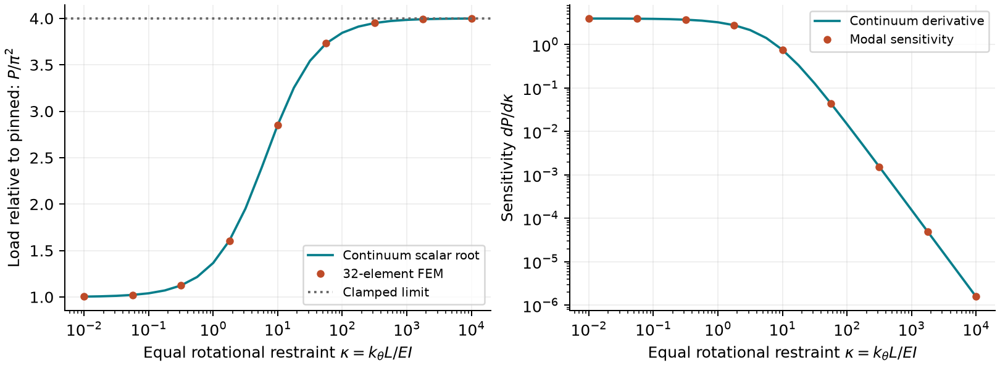

# BuckleMap

**How much does rotational restraint raise a column's buckling load, and when
does a precise eigenpair still give an inaccurate answer?**

An original C++17/Python investigation with exactly integrated Hermite elements,
an independent continuum reference, and reproducible load, shape and sensitivity
studies. No course handouts, solutions, private data or teaching code are included.

[Read the paper](paper/paper.pdf) · [LaTeX source](paper/paper.tex) ·
[Paper build](paper/README.md) · [Numerical records](examples/results/metrics.json)



## Recorded results

At unit length and rigidity, equal end springs `kappa=10` give a 32-element load
of **28.16771809**, versus a continuum load of **28.16769652**. At four elements,
the relative error is **0.2698%**, while the normalized matrix residual is about
6.12e-17. A small residual is not a continuum-error certificate. Final observed
load orders are 3.9979 (pinned) and 3.9904 (springs). These are synthetic numerical
verification results, not physical validation. [CSV tables](examples/results/)
retain unrounded outputs.

## Governing model and method

A straight, slender Euler-Bernoulli column of length `L` carries a constant
conservative compressive dead load `P`. With displacement `w`, rotation `w'`,
positive elementwise constant bending rigidity `EI`, and end springs `k0,kL`,

```math
\Pi_2=\tfrac12\int_0^L EI(w'')^2\,dx
 +\tfrac12 k_0w'(0)^2+\tfrac12 k_Lw'(L)^2
 -\tfrac12 P\int_0^L(w')^2\,dx.
```

Stationarity gives `(EI w'')'' + P w''=0` in smooth segments. Cubic Hermite
functions interpolate displacement and slope. The C++ core returns exactly
integrated `K_e=integral EI N''^T N'' dx` and `G_e=integral N'^T N' dx`.
Python assembles them, adds spring energy, eliminates constrained DOFs, applies
diagonal congruence scaling, and uses SciPy `eigh` to solve `K q=P G q`.
Modes satisfy `q_i^T G q_j=delta_ij`.

For pinned translations and equal springs, `kappa=k_theta L/EI` and
`z=sqrt(P L^2/EI)`. The symmetric continuum first mode is proportional to
`cos(z(x/L-1/2))-cos(z/2)`, with

```math
\kappa\sin(z/2)+z\cos(z/2)=0,\qquad \pi\le z\le2\pi.
```

This scalar root is independent of the FEM matrices. At `L=EI=1`, the derivative
for equal springs is `dP/dkappa=theta_left^2+theta_right^2` for a G-normalized
simple eigenmode. The study compares it with the continuum derivative.

## Install and run

Requires Python 3.11+ and a C++17 compiler. On Windows install Visual Studio
Build Tools with **Desktop development with C++**; Linux can use GCC or Clang.
CMake and pybind11 are provisioned by pip's isolated build when needed.

```sh
python -m venv .venv
# PowerShell: .venv\Scripts\Activate.ps1
# Linux/macOS: source .venv/bin/activate
python -m pip install -e ".[dev]"
bucklemap solve --elements 16 --support pinned --spring 10 --modes 3
bucklemap study --output output/study
python scripts/check_samples.py
```

`solve` emits JSON or writes `--output path.json`. The CLI uses `L=EI=1`;
the API supports dimensional and nonuniform models. `study` writes CSV/JSON and
two PNG figures. [requirements-tested.txt](requirements-tested.txt) records the
local Windows/Python 3.14 environment, not a universal lockfile. CI also resolves
compatible dependencies on Python 3.11.

```python
import numpy as np
from bucklemap import solve, reconstruct, spring_reference

x = np.linspace(0, 2.0, 33)
result = solve(x, 1000.0, support="pinned", springs=(5000, 5000), modes=3)
print(result.loads)  # forces; EI has units force*length**2
print(result.residuals)  # reduced-space backward errors
field = reconstruct(x, result.modes[:, 0], np.linspace(0, 2, 101))
reference = spring_reference(10) * 1000.0 / 2.0**2
```

## API contracts

| Function | Contract |
| --- | --- |
| `element_matrices(length, rigidity)` | Native 4x4 `(K_e,G_e)`; DOFs `[w0,theta0,w1,theta1]` |
| `assemble(nodes, rigidity=1)` | Full dense `(K,G)`; increasing finite nodes, positive scalar or per-element `EI` |
| `solve(nodes, rigidity=1, *, support, springs, modes)` | Sorted positive loads, full G-normalized mode columns, constrained DOFs zero |
| `reconstruct(nodes, dofs, points)` | Cubic displacement at in-domain points; no extrapolation |
| `spring_reference(kappa)` | Uniform-column first continuum load `P L^2/EI` for equal end springs |

Support presets: `pinned` fixes both translations; `clamped` fixes both
translations and rotations; `cantilever` fixes the left end; `clamped-pinned`
fixes the left end and right translation. Springs are left/right rotational
stiffnesses in force*length. Nonfinite/negative values and springs at fixed
rotations are rejected; use constraints for ideal clamps. All units must agree.

Residuals are `||K_r q-P G_r q||_inf / ((||K_r||_inf+P||G_r||_inf)||q||_inf)`.
They concern discrete matrices, depend on DOF scaling, and do not bound
continuum or physical error. Sensitivities assume simple eigenvalues.

## Verification and development

```sh
ruff check .
ruff format --check .
clang-format --dry-run --Werror cpp/beam.hpp cpp/bindings.cpp cpp/test_beam.cpp
python -m pytest -q
cmake -S . -B build/native -DBUCKLEMAP_PYTHON=OFF -DCMAKE_BUILD_TYPE=Release
cmake --build build/native --config Release
ctest --test-dir build/native -C Release --output-on-failure
python scripts/check_samples.py
python scripts/check_manifest.py
python -m build
```

The 53 Python tests cover independent polynomial quadrature of native matrices,
cubic field reconstruction, four Euler support cases, higher modes,
G-orthogonality, dimensional scaling, nested heterogeneous refinement, spring
monotonicity/derivatives, CLI and invalid inputs. Native CTest checks symmetry,
rigid modes and parameter rejection using explicit return codes, active in
Release builds. C++ warnings are errors.

CI checks Ubuntu/Python 3.11 and Windows/Python 3.14, reproduces samples, builds
wheel/sdist, tests the installed wheel, and independently compiles and renders
the paper with pdfLaTeX. `python -m build` builds the wheel from the source
distribution. The manuscript manifest hashes numerical inputs, implementation
and figures. Sample checks allow small BLAS-dependent rounding changes, not
byte-identical residuals or plots; exact tolerances appear in the script.

Two retained branches, `feat/column-eigenproblem` and
`validation/experiments-paper`, merge after applicable checks pass. Git retains
the configured author and actual timestamps; no reviews are invented.

## Limitations

- Ideal straight, slender planar columns and elastic bifurcation only: no
  imperfections, yielding, shear flexibility, postbuckling or physical
  validation. Eigenloads are not safe design loads.
- Constant conservative axial force; no follower forces, distributed axial
  loading, frames or arbitrary multipoint constraints.
- Dense quadratic storage/cubic solve cost; intended for moderate meshes and
  parameter contrasts. Scaling does not certify extremely ill-conditioned cases.
- Conforming Ritz eigenvalues are upper bounds in exact arithmetic with exact
  integration; no rigorous roundoff-aware error certificate is provided here.
- Nonuniform meshes and piecewise constant rigidity are supported and tested for
  consistency. The published accuracy study uses uniform rigidity and meshes.

## Concept provenance and public references

The local NFEM topics **linearized pre-buckling** and **critical points**, and
AFEM **Hermite interpolation**, motivated this project. Software-lab practices
motivate native/Python separation and reproducibility. No course content is
redistributed; code, experiments, figures and prose are original. There is no
claim of theoretical novelty, affiliation or peer review.

1. TU Delft, [Euler-Bernoulli beam elements](https://teachbooks.tudelft.nl/computational-modelling/structural_linear/euler_bernouilli.html).
2. TU Delft, [Geometrically nonlinear problems](https://teachbooks.tudelft.nl/computational-modelling/solid_nonlinear/geometric_nonlinearity.html).
3. TU Delft OpenCourseWare, [Stability of Beams](https://ocw.tudelft.nl/course-lectures/stability-of-beams/).
4. SciPy, [`scipy.linalg.eigh`](https://docs.scipy.org/doc/scipy/reference/generated/scipy.linalg.eigh.html).

MIT license; see [LICENSE](LICENSE).
