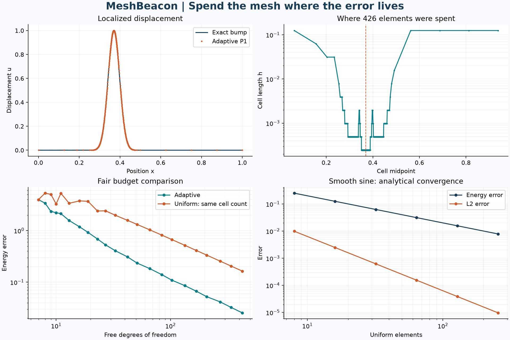

# MeshBeacon

[](https://github.com/racostacme-come/meshbeacon/actions/workflows/ci.yml)

**Spend the mesh where the error lives.** An original adaptive finite-element
laboratory for a bar under localized distributed loading. Every refinement decision
is inspectable, and adaptive and uniform meshes are compared at the **same element
count**. The equation also models steady 1D heat conduction with fixed endpoints.



The checked-in experiment uses 426 elements (425 free degrees of freedom).
Adaptive energy error is **0.02551**, versus **0.16420** on the uniform mesh:
about **6.4 times lower error** at the same discrete budget. This is one manufactured
localized-load experiment, not a general performance guarantee. Smooth sine
refinement yields orders **2.0000 in L2** and **1.0000 in energy**.

## Install and run

Python 3.11 or newer; NumPy, SciPy, and Matplotlib. No compiler required.

```bash
python -m venv .venv
# Windows PowerShell: .\.venv\Scripts\Activate.ps1
# Linux/macOS: source .venv/bin/activate
python -m pip install -e ".[dev]"
meshbeacon --output out
python examples/custom_load.py
```

`python -m meshbeacon.cli --output out` is equivalent. `--version` and `--help`
are available. The fixed benchmark exits nonzero if any validation check fails.
It creates the destination and replaces only these four named files on reruns:

| File | Contents |
| --- | --- |
| `convergence.csv` | Six sine refinements and 22 equal-cell bump comparison pairs |
| `adaptive_nodes.csv` | Final mesh, nodal solution, and analytical displacement |
| `validation.json` | Parameters, metrics, quadrature sensitivity, validation checks |
| `mesh_audit.png` | Displacement, mesh density, budget comparison, convergence |

Committed samples are in [results](results). Numbers reproduce within floating-point
tolerances across platforms; PNG bytes and library-dependent roundoff may differ.
[requirements-repro.txt](requirements-repro.txt) records the local Windows/Python
3.14 environment, not a universal cross-version lockfile.

## Governing equation and numerical method

On the nondimensional interval $x\in(0,1)$, solve

$$-a u''=f,\qquad u(0)=g_0,\quad u(1)=g_1,\qquad a>0.$$

For a bar, $a$ is constant axial rigidity in consistent units. The weak form is
$\int_0^1 a u'v'\,dx=\int_0^1 fv\,dx$ for homogeneous test functions. Continuous
piecewise-linear elements on an arbitrary increasing mesh give

$$K_e=\frac{a}{h_e}\begin{bmatrix}1&-1\\-1&1\end{bmatrix},\qquad
b_e=\int_{x_e}^{x_{e+1}}f\begin{bmatrix}1-t\\t\end{bmatrix}\,dx.$$

Endpoint values are eliminated with a right-hand-side correction. SciPy's LAPACK
banded solver solves the tridiagonal system. Assembly and solve use linear storage
and work at fixed quadrature order. Default load integration uses eight
Gauss-Legendre points per cell.

## Estimate, mark, refine

Cell flux is $q_e=a(u_{e+1}-u_e)/h_e$. Interior-node jumps are
$J_i=q_i-q_{i-1}$. The estimator convention is

$$\eta_e^2=\frac{h_e^2}{a}\int_e f^2\,dx+
\frac{h_e}{2a}\sum_{i\in\partial e\cap(0,1)}J_i^2,
\qquad \eta=\sqrt{\sum_e\eta_e^2}.$$

Dirichlet endpoints have no jump term. This is an **uncalibrated residual estimator**,
not a certified upper bound. The report includes effectivity
$\eta/\|u-u_h\|_E$, where $\|e\|_E^2=\int_0^1 a(e')^2\,dx$.

1. Solve and compute squared cell contributions.
2. Sort largest first, breaking ties by cell index.
3. Select the smallest prefix reaching $\theta\sum_e\eta_e^2$.
4. Bisect selected cells, preserving old nodes; solve again.

Default bulk fraction is $\theta=0.5$. In 1D no conformity closure is needed.
`theta=1` selects all positive contributions; a zero total marks no cells.
`adapt` stops at the absolute estimator tolerance, or returns `max_elements` or
`max_steps`. Hitting a budget is not convergence. A marked set exceeding the budget
is rejected in full; the previous solved mesh is returned. History is retained,
so total memory can exceed the storage of the final solve.

## Python API

```python
from meshbeacon.core import adapt, errors, solve
from meshbeacon.problems import bump

problem = bump(center=0.37, width=0.04)
run = adapt(problem.load, theta=0.5, tolerance=0.15, max_elements=4096)
solution = run.solution
print(run.stop_reason, solution.elements, solution.estimator)
print(errors(solution, problem.exact, problem.gradient))  # L2, energy
print(solution.evaluate([0.25, 0.37, 0.5]))
bar = solve([0, 0.1, 0.4, 1], lambda x: 2.0, diffusion=3, boundary=(1, 2))
```

Fields receive arrays of shape `(elements, quadrature_points)` and return finite,
broadcast-compatible values; scalar constants work. `solve` accepts quadrature
orders 2–32. `adapt` also accepts `initial_nodes`, `diffusion`, `boundary`,
`quadrature`, and `max_steps`. `mesh`, `mark`, and `refine` are independently usable.
Solver arrays are read-only; copy before editing. `evaluate` rejects extrapolation.
Invalid meshes, diffusion, budgets, and nonfinite field values fail explicitly.

## Validation and development

```bash
ruff check .
ruff format --check .
python -m pytest --cov=meshbeacon --cov-report=term-missing --cov-fail-under=90
python -m build
python -m pip install --force-reinstall --no-deps dist/meshbeacon-0.1.0-py3-none-any.whl
python -m pytest
meshbeacon --output out
python -m pip check
```

Tests cover a nonuniform affine patch with nonzero endpoints, exact quadratic
nodal values and closed-form errors, a hand-computed estimator, diffusion scaling,
sine convergence, minimal bulk marking, nested bisection, adaptive accuracy,
resource limits, invalid inputs, and reproducible numeric output. CI runs Ubuntu
and Windows with Python 3.11/3.14, testing editable and built-wheel installations,
building wheel/source archives, running the CLI/example, linting, and checking
dependencies. See [validation](docs/validation.md) and [contributing](CONTRIBUTING.md).

## Limitations

- Constant diffusion, a unit interval, linear static physics, and two Dirichlet
  endpoints only. No material interfaces, Neumann conditions, dynamics, nonlinear
  laws, multidimensional mesh, or coarsening.
- The manufactured bump is $b(x)=\exp(-((x-0.37)/0.04)^2)$ and
  $u=b-(1-x)b(0)-xb(1)$, with $f=-a b''$. Signed loads are intentional.
- A load narrower than the mesh/quadrature resolution can be missed by both solve
  and estimator. Supply a resolving initial mesh or raise quadrature order. The
  report's sensitivity check is evidence for this example, not universal detection.
- Error norms use analytical derivatives and independent 16-point quadrature;
  these are numerical integrals, not rigorous interval bounds.
- Fine or strongly graded meshes may become ill-conditioned. Extreme scales,
  overflow, and roundoff-limited refinement are not comprehensively certified.
- Equal DOFs do not imply equal runtime: adaptation performs multiple solves.
  This project compares accuracy per discrete budget.
- This run uses Python with compiled NumPy/SciPy kernels. Earlier series projects
  contain original C++ cores; an extra native extension is unnecessary here.

## Originality and references

Original implementation and examples. Local AFEM folder/file names for 1D linear
basis functions and convergence studies informed the topic; software-lab practices
motivate the checked branch workflow. No handouts, solutions, exams, source
exercises, or private datasets were opened, copied, or published. No ATSA work.

- W. Dörfler, *A Convergent Adaptive Algorithm for Poisson's Equation*, SIAM J.
  Numer. Anal. 33(3), 1106–1124 (1996), [doi:10.1137/0733054](https://doi.org/10.1137/0733054).
  Source of bulk marking; its 2D result is not a proof for this implementation.
- [scikit-fem example 22](https://scikit-fem.readthedocs.io/en/latest/listofexamples.html#example-22-adaptive-poisson-equation)
  is a public reference for cell-residual and flux-jump indicators. MeshBeacon uses
  its own 1D discretization, weights, assembly, and tests.

MIT licensed. Git history records actual work; no external review is implied.

## Academic paper

Read the [research note (PDF)](paper/paper.pdf), edit the [LaTeX source](paper/paper.tex),
or follow the [compilation instructions](paper/README.md). The manuscript includes
methods, measured validation, limitations, and references within five pages.
