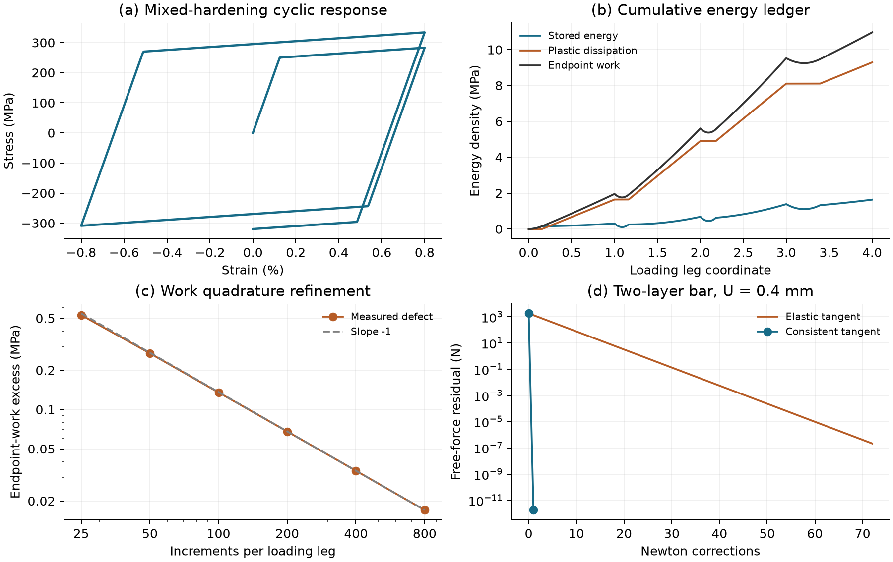

# YieldLedger

**Separate plastic dissipation from the work error caused by coarse increments.**
A C++17 uniaxial return-mapping kernel, Python finite-element solver, and reproducible
energy audit for cyclic plasticity with mixed linear hardening.



Original academic manuscript: [PDF](paper/paper.pdf) | [LaTeX](paper/paper.tex).
These are synthetic model-verification experiments, not real-material measurements.

## Recorded results

- The analytical two-layer bar stress is **232.142857 MPa**. Aligned meshes of
  2, 8, and 32 elements give maximum stress error below **1.4e-12 MPa**.
- The two-element example needs **1 consistent-tangent correction versus 72
  elastic-tangent corrections** at the same tolerance. These are not timing speedups.
- The 1,600-increment cycle dissipates **9.287179 MPa** in energy-density units.
  Endpoint work includes **0.033964 MPa** of quadrature excess. The cumulative
  identity closes within **8.8e-14 MPa**.
- Refinement from 400 to 800 increments per leg gives defect order **0.9984**.

Full precision: [metrics.json](results/metrics.json) and adjacent CSV arrays.
The experiment command fails explicitly if numerical acceptance gates fail.

## Governing equations and method

Small axial strain, quasistatic equilibrium, constant area, no body force:

```text
epsilon = du/dx = epsilon_e + p;   sigma = E (epsilon - p)
f = |sigma - Hk p| - (sigma_y + Hi alpha) <= 0
dp = sign(sigma - Hk p) dgamma;    dalpha = dgamma >= 0
f dgamma = 0;                    d(A sigma)/dx = 0
```

From committed `(p_n, alpha_n)`, evaluate the elastic trial stress. If the trial
yield function is positive, correct with `dgamma = f_trial/(E + Hi + Hk)`.
The consistent tangent is `E*(Hi+Hk)/(E+Hi+Hk)` in a plastic step and `E` otherwise.
At exactly zero trial yield, the elastic one-sided tangent is selected; no classical
derivative exists at that kink.

P1 bar elements use constant strain and one material point. Solve the assembled
free-node residual by dense Newton iteration with residual-based backtracking.
Every trial uses the same committed material history. Only converged steps return;
failures leave their input state unchanged. The FEM requires positive total hardening
to avoid fully plastic singular tangents; the kernel supports perfect plasticity.

Stored energy is `psi = E*epsilon_e^2/2 + Hi*alpha^2/2 + Hk*p^2/2`. The ledger obeys

```text
sigma_new * delta_epsilon = delta_psi + sigma_y * delta_alpha + Q
Q = (E*delta_epsilon_e^2 + Hi*delta_alpha^2 + Hk*delta_p^2)/2 >= 0.
```

`sigma_y*delta_alpha` is irreversible dissipation. `Q` is endpoint-work excess,
not physical dissipation. Hardening energy is stored. This algebraic identity
also holds across yield transitions; the manuscript derives it.

## Build and run

Requires Python >=3.11, CMake >=3.20 and C++17 (GCC/Clang or MSVC).
Windows needs Visual Studio C++ build tools and a Windows SDK.

```bash
python -m venv .venv
# Linux/macOS: source .venv/bin/activate
# PowerShell: .venv/Scripts/Activate.ps1
python -m pip install -e ".[dev]"
yieldledger --output results
python examples/two_layer.py
```

scikit-build-core and pybind11 compile the extension; there is no silent fallback.
Standalone C++ checks without Python bindings:

```bash
cmake -S . -B build/native -DYIELDLEDGER_PYTHON=OFF
cmake --build build/native --config Release
ctest --test-dir build/native -C Release --output-on-failure
```

## API

```python
from yieldledger import Material, State, Bar, solve_step, ledger

m = Material(elastic=200000, yield_stress=250, isotropic=2000, kinematic=3000)
trial = m.update(strain=0.004, old=State())
print(trial.stress, trial.tangent, trial.state.accumulated)
audit = ledger(m, [0, 0.004, -0.004, 0])
bar = Bar([40, 60], (m, Material(100000, 400, 5000, 5000)), area=10)
first = solve_step(bar, 0.3)
second = solve_step(bar, -0.3, previous=first)
```

`Material`, `State`, `Response` expose read-only fields. A converged `Step` contains
displacements, states, stresses, correction count and residual history. Use a previous
step only with the same model and units. `ledger` requires a finite 1D path starting
at zero; include every reversal. Examples use N, mm and MPa, so energy density is MPa
and bar energy is N mm. Force convergence uses `atol=1e-10` N and `rtol=1e-10`:
`max(abs(free residual)) <= atol + rtol*max(1, max(abs(element force)))`.
`tangent="elastic"` exposes the slower comparison. Failures raise `ConvergenceError`.

## Reproduction and checks

```bash
python -m pytest
ruff check .
ruff format --check .
clang-format --dry-run --Werror cpp/material.hpp cpp/bindings.cpp cpp/test_material.cpp
python -m build
yieldledger --output build/reproduced
python scripts/check_reproduction.py
python paper/build.py --engine pdflatex
```

The paper builder also accepts Tectonic and checks the five-page limit, nonempty
pages, overfull boxes and references. See [paper instructions](paper/README.md).
CI covers Ubuntu/Python 3.11 and Windows/Python 3.14, distributions, native tests,
sample reproduction and Linux manuscript compilation. Linux also runs native
address/undefined-behavior sanitizers. Four CSV arrays are compared with
`rtol=2e-6, atol=1e-8`; numerical gates apply independently. Mesh correction counts
can vary at yield kinks and are excluded from that comparison.

## Limits and interpretation

This is a compact verification code, not an engineering design solver. It is uniaxial,
rate-independent, isothermal and small-strain, with linear hardening. There is no
damage, multiaxial J2 law, fatigue prediction or physical calibration. Dense solves
target small examples. Automatic increment cutback is not implemented.

The aligned two-layer continuum displacement is piecewise affine, already in the P1
space. Tiny reported errors measure algebraic/roundoff error, not general spatial
convergence. Material endpoints are exact along resolved monotonic strain legs for
this law; omitted reversals lose path information. Work-quadrature error and physical
constitutive-model validity are separate questions. No general convergence guarantee
or timing speedup is claimed.

## Provenance and references

Original implementation, prose and synthetic data, motivated by local NFEM topics on
sources of nonlinearity, residual equations and equilibrium, and reproducible
software-lab practices. No course handouts, solutions, or private data are included.

- J. Bleyer et al., [Elasto-plastic analysis of a 2D von Mises material](https://bleyerj.github.io/comet-fenicsx/tours/nonlinear_problems/plasticity/plasticity.html):
  background on return mapping and tangents, not source code used here.
- MOOSE, [Combined Nonlinear Hardening Plasticity](https://mooseframework.inl.gov/moose/source/materials/CombinedNonlinearHardeningPlasticity.html):
  broader nonlinear multiaxial mixed hardening, not the specific law used here.

MIT licensed. This is a project report, with no claimed affiliation, peer review,
or algorithmic novelty. Git records actual development and validation.
